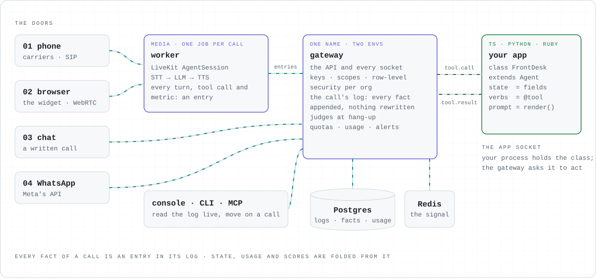

<p align="center">
  <a href="https://github.com/pinecall/pinecall">
    
  </a>
</p>

<p align="center">
  <a href="https://docs.pinecall.io/start/quickstart/"><b>Quickstart</b></a> ·
  <a href="https://docs.pinecall.io">Docs</a> ·
  <a href="https://github.com/pinecall/pinecall">Source</a> ·
  <a href="https://cloud.pinecall.io/sandbox/">Console</a> ·
  <a href="https://pinecall.io">pinecall.io</a>
</p>

<p align="center">
  <a href="https://www.npmjs.com/package/pinecall"></a>
  <a href="https://pypi.org/project/pinecall-runtime/"></a>
  <a href="https://github.com/pinecall/pinecall/tags"></a>
</p>

<br>

```text
 ┌─ phone ─┐  ┌─ browser ─┐  ┌─ chat ─┐  ┌─ WhatsApp ─┐
 └────┬────┘  └─────┬─────┘  └───┬────┘  └─────┬──────┘
      └─────────────┴─────┬──────┴─────────────┘
                     one agent ── one class ── one log
```

**You write the agent as a class. Pinecall answers the phone.** The class's fields are the call's
state, its `@tool` methods are what the model may do, and `render()` is the prompt. Pinecall runs
the rest: the phone line, the browser call, WhatsApp, speech in and out, memory, retrieval, judges
at hang-up, the console and the bill. You can write the agent in TypeScript, Python or Ruby.

```tsx
export default class FrontDesk extends Agent {
  stage: Stages<"ask" | "done"> = "ask";

  /** Writes down the caller's message, once they have said their name and what it is about. */
  @tool({ stage: "ask", pii: ["name"] })
  async takeMessage(name: string, about: string) {
    this.stage = "done";
    return { name, about };
  }
}
```

```console
$ npm i -g pinecall && pinecall new acme --agent front-desk
$ pinecall chat        # talk to it
$ pinecall test        # its goldens, judged against a real model
$ pinecall deploy up   # it answers calls
```

<p align="center">
  <picture>
    <source media="(prefers-color-scheme: dark)" srcset="assets/architecture-dark.svg">
    
  </picture>
</p>

| | |
|---|---|
| [**pinecall/pinecall**](https://github.com/pinecall/pinecall) | the runtime, the CLI and its MCP server, the console, the widget, and the SDKs for TypeScript, Python and Ruby, all released at one version |
| [**docs.pinecall.io**](https://docs.pinecall.io) | the quickstart, the class, testing, the phone, self-hosting, and a page for every CLI verb |
| [**cloud.pinecall.io**](https://cloud.pinecall.io/sandbox/) | Pinecall Cloud: a sandbox to try an agent where nothing reaches a real caller |

<p align="center">
  <sub><code>$ pinecall --help</code></sub>
</p>
